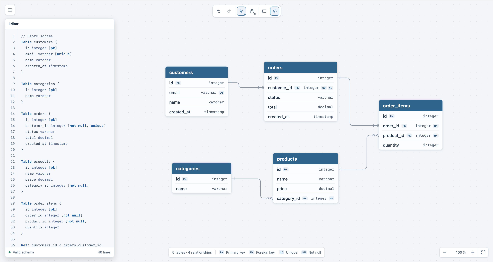
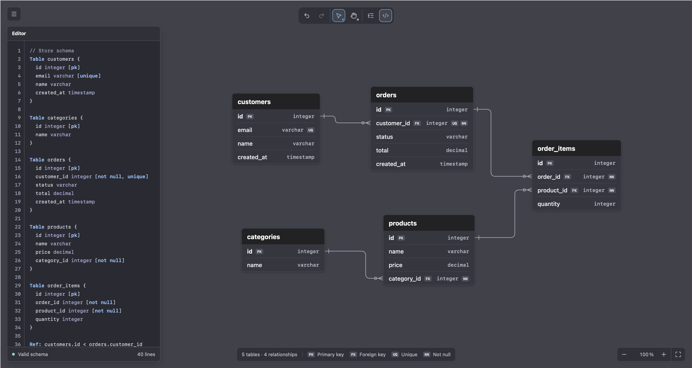
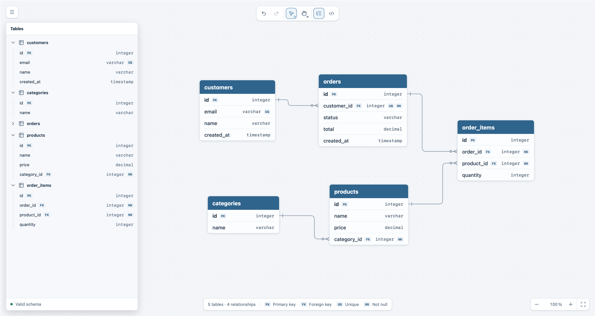
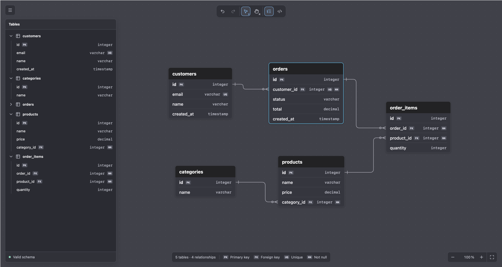

# Schema Studio

Schema Studio is a browser-based editor for database diagrams. Paste DBML to see your tables and how they connect.

[Try the live demo](https://erd-editor-phi.vercel.app)

## Screenshots

  &nbsp;&nbsp;
  

  &nbsp;&nbsp;
  

## Features

- Edit DBML with a live preview, syntax highlighting, and error messages.
- Move tables, pan and zoom, or fit the whole diagram on screen.
- Hover over tables, fields, or connections to highlight them and see which fields are linked.
- Download the full diagram as a PNG or JPG. PNG can have a transparent background.
- Choose light, dark, or system theme. Your draft and theme are saved in your browser.

## Run locally

Run `npm ci`, then `npm run dev`. Open [localhost:4173](http://127.0.0.1:4173/).

## Specs

See the [technical specs](specs/README.md) for details on the design and features.

## License

[MIT License](LICENSE)
