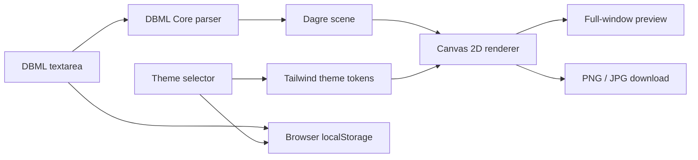

# Application runtime

## Architecture

Schema Studio is a browser-local Next.js App Router app written in
TypeScript. The root route renders a client workspace. Its React effect
mounts the editor and canvas controller after hydration and cleans up event
listeners, timers, animation frames, and the resize observer on unmount.
An inline script in the document head applies the saved theme or system
appearance before the first paint.
Schema normalization and layout live in `src/schema.ts`. Canvas 2D
rendering lives in `src/draw.ts`. Tailwind utilities and theme tokens live
in `src/style.css` and compile through PostCSS.
[Root layout](../../app/layout.tsx) · [Theme setup](../../src/theme.ts) · [Workspace](../../app/editor-workspace.tsx) · [Controller](../../src/editor-controller.ts)

## Storage and boundaries

- Browser storage keys are `schema-studio:source` and
  `schema-studio:theme`. The draft saves on input. The preference saves on
  theme selection. When storage is unavailable, the app still works for
  the current page session.
- Zoom, table positions, open menus, and export options live in memory
  and reset on reload.
- No app server or database connection is used. Source parsing and image
  generation happen in the browser. The diagram is rendered as canvas
  pixels. Assistive technology receives counts and control labels, while
  the editable DBML source provides the schema text.

## Build and verification

| Command | Result |
| --- | --- |
| `npm ci` | Install the dependencies recorded in the lockfile. |
| `npm run build` | Build the Next.js app, check TypeScript, and export HTML and bundled assets to `out/`. |
| `npm run dev` | Start the Next.js development server on port 4173. |
| `npm run preview` | Serve an existing production export from `out/` on port 4173. |
| `npm run typecheck` | Check the TypeScript source and tests without building. |
| `npm test` | Run the Node test suite for the schema model, parser diagnostics, and layout. |

Serve the production export over HTTP so the Next.js assets resolve from
the site root. Browser storage is tied to the origin, including its port.

Run the parser tests and build after implementation changes. For interaction
or style changes, also check the affected UI in light and dark modes, at
desktop and phone widths. Verify keyboard access and actual downloaded images
when changing the menu, dialog, navigation, or export.

[Build commands and dependency versions](../../package.json) · [Automated tests](../../test/schema.test.ts)
